# MyEnterprise — entity-relationship diagram

Generated from the installed database by `php tools/er-diagram.php`. 31 tables (the 30 of the design plus ProductImage); `||--o{` reads "one to zero-or-many".
PK = primary key, FK = foreign key, UK = unique. Columns and the table added to the original design are listed in docs/DATABASE.md.

```mermaid
erDiagram
    Customer ||--o{ Cart : "customer_id"
    Cart ||--o{ CartItem : "cart_id"
    ProductVariant ||--o{ CartItem : "variant_id"
    ProductVariant ||--o{ CompatibilityRule : "source_variant_id"
    ProductVariant ||--o{ CompatibilityRule : "target_variant_id"
    Customer ||--o{ CustomerOrder : "customer_id"
    Admin |o--o{ Fulfillment : "admin_id"
    CustomerOrder ||--o{ Fulfillment : "order_id"
    ProductVariant ||--o{ Inventory : "variant_id"
    Warehouse ||--o{ Inventory : "warehouse_id"
    Fulfillment ||--o{ OrderAllocation : "fulfillment_id"
    OrderItem ||--o{ OrderAllocation : "order_item_id"
    Shipment |o--o{ OrderAllocation : "shipment_id"
    Warehouse ||--o{ OrderAllocation : "warehouse_id"
    Admin |o--o{ OrderCancellation : "cancelledBy"
    CustomerOrder ||--o{ OrderCancellation : "order_id"
    CustomerOrder ||--o{ OrderItem : "order_id"
    ProductVariant ||--o{ OrderItem : "variant_id"
    CustomerOrder ||--o{ Payment : "order_id"
    Admin ||--o{ Product : "admin_id"
    Category ||--o{ ProductCategory : "category_id"
    Product ||--o{ ProductCategory : "product_id"
    Admin |o--o{ ProductImage : "uploadedBy"
    Product ||--o{ ProductImage : "product_id"
    ProductVariant ||--o{ ProductSpecification : "variant_id"
    Product ||--o{ ProductVariant : "product_id"
    Supplier ||--o{ PurchaseOrder : "supplier_id"
    Warehouse ||--o{ PurchaseOrder : "warehouse_id"
    PurchaseOrder ||--o{ PurchaseOrderItem : "purchase_order_id"
    ProductVariant ||--o{ PurchaseOrderItem : "variant_id"
    ReturnItem ||--o{ Refund : "return_item_id"
    Transaction |o--o{ Refund : "transaction_id"
    OrderItem ||--o{ ReturnItem : "order_item_id"
    ReturnRequest ||--o{ ReturnItem : "return_request_id"
    Customer ||--o{ ReturnRequest : "customer_id"
    CustomerOrder ||--o{ ReturnRequest : "order_id"
    Fulfillment ||--o{ Shipment : "fulfillment_id"
    ProductVariant ||--o{ StockMovement : "variant_id"
    Warehouse ||--o{ StockMovement : "warehouse_id"
    Supplier ||--o{ SupplierProduct : "supplier_id"
    ProductVariant ||--o{ SupplierProduct : "variant_id"
    Payment ||--o{ Transaction : "payment_id"
    ProductVariant ||--o{ Warranty : "variant_id"
    OrderItem ||--o{ WarrantyClaim : "order_item_id"
    Warranty ||--o{ WarrantyClaim : "warranty_id"
    Customer {
        int_11_ customer_id PK
        varchar_100_ email UK
        varchar_50_ firstName
        varchar_50_ lastName
        varchar_20_ phone
        varchar_255_ password_hash
        datetime createdAt
    }
    Admin {
        int_11_ admin_id PK
        varchar_100_ email UK
        varchar_30_ role
        varchar_100_ fullName
        varchar_255_ password_hash
        tinyint_1_ isActive
        datetime createdAt
    }
    Product {
        int_11_ product_id PK
        int_11_ admin_id FK
        varchar_100_ name
        varchar_80_ brand
        text description
        tinyint_1_ isActive
        varchar_120_ slug UK
        datetime createdAt
    }
    Category {
        int_11_ category_id PK
        varchar_80_ category_name UK
        varchar_80_ slug UK
        varchar_20_ category_group
        smallint_6_ sortOrder
    }
    ProductCategory {
        int_11_ product_id PK,FK
        int_11_ category_id PK,FK
    }
    ProductVariant {
        int_11_ variant_id PK
        int_11_ product_id FK
        varchar_80_ sku UK
        varchar_150_ configuration
        varchar_50_ color
        decimal_10_2_ price
        char_7_ color_hex
        smallint_6_ sortOrder
        tinyint_1_ isActive
    }
    ProductSpecification {
        int_11_ specification_id PK
        int_11_ variant_id FK
        varchar_80_ spec_name
        varchar_150_ spec_value
        varchar_30_ unit
    }
    CompatibilityRule {
        int_11_ rule_id PK
        int_11_ source_variant_id FK
        int_11_ target_variant_id FK
        varchar_30_ compatibility_type
    }
    ProductImage {
        int_11_ image_id PK
        int_11_ product_id FK
        varchar_50_ color
        smallint_6_ sortOrder
        varchar_20_ mime_type
        smallint_6_ width
        smallint_6_ height
        varchar_160_ alt_text
        varchar_255_ credit
        mediumblob data
        int_11_ byte_size
        char_64_ sha256 UK
        int_11_ uploadedBy FK
        datetime createdAt
    }
    Cart {
        int_11_ cart_id PK
        int_11_ customer_id FK
        varchar_20_ status
        datetime createdAt
        datetime updatedAt
        int_11_ active_customer_id UK
    }
    CartItem {
        int_11_ cart_item_id PK
        int_11_ cart_id FK
        int_11_ variant_id FK
        int_11_ quantity
        decimal_10_2_ unit_price
        datetime addedAt
    }
    CustomerOrder {
        int_11_ order_id PK
        int_11_ customer_id FK
        varchar_50_ orderNumber UK
        varchar_30_ status
        decimal_10_2_ totalAmount
        datetime placedAt
        varchar_20_ deliveryMethod
        decimal_10_2_ shippingFee
        varchar_100_ shipRecipient
        varchar_150_ shipLine1
        varchar_80_ shipCity
        varchar_80_ shipRegion
        varchar_20_ shipPostalCode
        char_2_ shipCountry
    }
    OrderItem {
        int_11_ order_item_id PK
        int_11_ order_id FK
        int_11_ variant_id FK
        int_11_ quantity
        decimal_10_2_ unitPrice
    }
    Warehouse {
        int_11_ warehouse_id PK
        varchar_80_ name UK
        varchar_200_ location
        int_11_ capacity
    }
    Inventory {
        int_11_ warehouse_id PK,FK
        int_11_ variant_id PK,FK
        int_11_ quantity_on_hand
        int_11_ quantity_reserved
        int_11_ reorder_level
        datetime updatedAt
    }
    StockMovement {
        int_11_ movement_id PK
        int_11_ warehouse_id FK
        int_11_ variant_id FK
        int_11_ quantity_change
        varchar_80_ reason
        datetime movedAt
        varchar_50_ reference
    }
    Supplier {
        int_11_ supplier_id PK
        varchar_100_ name UK
        varchar_100_ contact
    }
    SupplierProduct {
        int_11_ supplier_id PK,FK
        int_11_ variant_id PK,FK
        decimal_10_2_ unit_cost
        int_11_ lead_time_days
        int_11_ minimum_order_qty
    }
    PurchaseOrder {
        int_11_ purchase_order_id PK
        int_11_ supplier_id FK
        int_11_ warehouse_id FK
        varchar_30_ status
        datetime orderedAt
        datetime receivedAt
    }
    PurchaseOrderItem {
        int_11_ po_item_id PK
        int_11_ purchase_order_id FK
        int_11_ variant_id FK
        int_11_ quantity
        decimal_10_2_ unit_cost
    }
    Payment {
        int_11_ payment_id PK
        int_11_ order_id FK
        decimal_10_2_ amount
        varchar_30_ status
        varchar_30_ method
        datetime createdAt
    }
    Transaction {
        int_11_ transaction_id PK
        int_11_ payment_id FK
        varchar_30_ transactionType
        decimal_10_2_ amount
        varchar_30_ status
        varchar_40_ reference UK
        datetime createdAt
    }
    Fulfillment {
        int_11_ fulfillment_id PK
        int_11_ order_id FK,UK
        int_11_ admin_id FK
        varchar_30_ status
        datetime createdAt
    }
    OrderAllocation {
        int_11_ allocation_id PK
        int_11_ order_item_id FK
        int_11_ warehouse_id FK
        int_11_ fulfillment_id FK
        int_11_ shipment_id FK
        int_11_ allocated_qty
        varchar_20_ status
    }
    Shipment {
        int_11_ shipment_id PK
        int_11_ fulfillment_id FK
        varchar_100_ trackingNumber UK
        varchar_30_ status
        varchar_40_ carrier
        datetime shippedAt
        datetime deliveredAt
    }
    OrderCancellation {
        int_11_ cancellation_id PK
        int_11_ order_id FK,UK
        int_11_ cancelledBy FK
        varchar_255_ reason
        datetime cancelledAt
        varchar_10_ initiatedBy
    }
    ReturnRequest {
        int_11_ return_request_id PK
        int_11_ order_id FK
        int_11_ customer_id FK
        varchar_30_ status
        varchar_255_ reason
        datetime requestedAt
        datetime resolvedAt
    }
    ReturnItem {
        int_11_ return_item_id PK
        int_11_ return_request_id FK
        int_11_ order_item_id FK
        int_11_ quantity
    }
    Refund {
        int_11_ refund_id PK
        int_11_ return_item_id FK
        int_11_ transaction_id FK,UK
        decimal_10_2_ amount
        varchar_30_ status
        datetime createdAt
    }
    Warranty {
        int_11_ warranty_id PK
        int_11_ variant_id FK
        int_11_ duration_months
        text coverage
    }
    WarrantyClaim {
        int_11_ claim_id PK
        int_11_ warranty_id FK
        int_11_ order_item_id FK
        varchar_255_ reason
        varchar_30_ status
        datetime submittedAt
        varchar_255_ resolution
        datetime resolvedAt
    }
```

